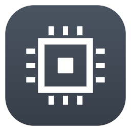

# FygoOS/fnOS 应用仓库

[English](README.md) | 简体中文

[FnDepot](https://github.com/EWEDLCM/FnDepot) (FygoOS/fnOS 第三方应用商店)的应用源。

## 添加此源

在 [FnDepot](https://github.com/EWEDLCM/FnDepot) 客户端中添加：

```
https://github.com/jiaaom/FnDepot
```

## 应用列表

| 图标 | 应用 | 简介 | 源码 |
| :---: | --- | --- | --- |
|  | [T6 驱动](t6/README.zh-CN.md)<br>`t6-drivers` | UnifyDrive UP6 / 极空间 T6 的内核驱动：风扇、LED、背光、电池、触摸屏等。需第一个安装。 | [up6-linux-drivers](https://github.com/jiaaom/up6-linux-drivers) |
|  | [T6 控制中心](t6/README.zh-CN.md)<br>`t6-control` | 风扇曲线、LED、屏幕亮度、电池充电上限和蜂鸣器设置。需先安装 T6 驱动。 | [up6-linux-drivers](https://github.com/jiaaom/up6-linux-drivers) |
|  | [T6 前面板](t6/README.zh-CN.md)<br>`t6-panel` | 前置触摸屏应用：仪表盘、设备设置，内置视频和音乐播放器。需先安装 T6 控制中心。 | [up6-linux-drivers](https://github.com/jiaaom/up6-linux-drivers) |

各应用的源码和问题反馈地址见其说明页。
